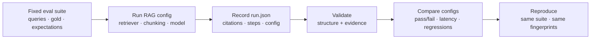

# citereel

**A developer tool for understanding *why* a RAG system answered that way — and what changed after you tweak it.**

Not another knowledge-base chatbot. CiteReel records retrieval → generation → citations as an inspectable run, checks whether evidence actually supports each claim, and lets you compare configs on a fixed eval suite so results stay reproducible.

[](https://github.com/L00PLeGeNd/citereel/actions/workflows/ci.yml)
[](https://pypi.org/project/citereel/)

**Docs:** [Usage guide](docs/USAGE.md) · [Enterprise notes](docs/ENTERPRISE.md)

## 30 seconds: catch a fake citation

A `[1]` that maps to a real chunk can still be **wrong**. No API key:

```bash
pip install citereel
citereel x
```

You should see **structure ok** and **evidence fail** (answer says 90 days; handbook says 14). That gap is the whole product.

Then compare two retrievers on a fixed suite:

```bash
citereel e -n offline-emb -g offline -o ./eval_out
citereel e -n offline-kw -R keyword -g offline -o ./eval_out2 \
  -A ./eval_out/report__offline-emb.json
```

## Why it exists

When you change a retriever, prompt, model, or chunking strategy, you need more than “the answer looks better.” CiteReel helps you answer:

| Question | How CiteReel helps |
|---|---|
| What evidence did this answer cite? | Run record maps `[n]` → chunk text |
| Does that evidence *really* support each claim? | Structure check **plus** semantic evidence eval (`check -E`) |
| Did quality get better or worse after a change? | Fixed eval suite + config comparison report |
| Was the failure retrieval, generation, chunking, or citation mapping? | Failure kinds on each eval case |
| Can someone else reproduce my conclusion? | Same suite JSON + saved runs + config / docs fingerprints |

> **Important:** a correct citation *format* does not mean a correct answer. Structure validation only proves mapping integrity. Semantic support is a separate check — and still an assist signal for human review, not a proof of truth.

## Architecture

```text
docs/ ──ingest──► chunks ──retrieve──► top-k ──generate──► answer + [n]
                      │                    │                    │
                      └──────── docs_fingerprint / config ──────┘
                                         │
                              run.json (schema + meta)
                                         │
                    ┌────────────────────┼────────────────────┐
                    ▼                    ▼                    ▼
              check / check -E      replay / diff         eval suite
              structure+evidence    config banner         pass% · kinds
```

| Layer | Today | Value you get |
|---|---|---|
| Retrieval | keyword, embedding (+ embedder id in config) | Score hit/miss against gold evidence tokens |
| Generation | offline + OpenAI-compatible | Compare answer quality/stability across configs |
| Citations | structure map + integrity | Evidence eval: support / refute / insufficient |
| Records | JSON runs | Config snapshot (chunking, k, model, version), docs fingerprint, schema |
| Diff / eval | answer · cites · retrieved · config | Suite reports with pass% / latency / regressions |

## Workflow



## Quick start

Full walkthrough (install → demo → ask → check → eval → GUI): **[Usage guide](docs/USAGE.md)**.

```bash
pip install citereel
# optional: pip install "citereel[llm]" "citereel[gui]"
```

```bash
# Interactive demo (writes examples/sample_run.json when run from a checkout)
citereel d -g offline
citereel s 1              # jump to citation [1]
citereel h                # HTML with clickable cites
citereel c -E             # structure + semantic evidence

# Fixed-suite eval (bundled demo-refund, no API key)
citereel e -n offline-emb -o ./eval_out

# Change one knob, compare
citereel e -n offline-kw -R keyword -o ./eval_out2 \
  -A ./eval_out/report__offline-emb.json
```

Ask your own docs:

```bash
citereel a "What is the refund window?" -d ./my_docs -g offline -o run.json
citereel c run.json -E
citereel df run_a.json run_b.json
```

Desktop shell: `citereel g` (install `citereel[gui]` for a native window; otherwise opens the browser).

## Who it is for

- **RAG developers** — debug weak retrieval, missing cites, or silent answer drift  
- **AI app builders** — leave comparable run records when swapping models / prompts / retrievers  
- **Learners & researchers** — see how chunking, retrieve, generate, cite, and eval connect  
- **OSS contributors** — a small Python surface for CLI, modules, tests, and CI around AI engineering  

MIT licensed. Using an online model may incur *provider* fees; CiteReel itself is free and open source.

## What it is / is not

**Is**

- A **run recorder + citation inspector + eval/compare harness** for local (or API-backed) RAG  
- Early-stage **engineering tooling**, with a full basic loop: retrieve → generate → record → check → replay → diff/eval  

**Is not**

- A hosted knowledge-base / chat product with accounts, billing tiers, or a managed corpus UI  
- An enterprise “evaluation platform” with dashboards, RBAC, or guaranteed semantic entailment  
- A replacement for human judgment — evidence checks are heuristics to *surface* bad cites, not certify truth  

Long-term value hangs on three questions we keep optimizing for:

1. Can we reliably tell whether an answer is actually supported by evidence?  
2. Can we fairly compare RAG configs on a fixed suite?  
3. Can another developer reproduce and verify a result?

## Eval suite (quantified compare)

Bundled `demo-refund` has **10 fixed cases** over handbook + FAQ (no API key). Change one knob and compare pass rate, latency, and failure kinds:

```bash
citereel e -n offline-emb -g offline -o ./eval_out
citereel e -n offline-kw -R keyword -g offline -o ./eval_out2 \
  -A ./eval_out/report__offline-emb.json
```

Example output (latencies vary by machine):

```text
eval  suite=demo-refund  config=offline-emb
pass  10/10 (100%)  latency=71.5ms
docs  b90f4cc653deb72d…
  ok    refund-window  8ms
  ok    late-refund-credit  7ms
  ok    activated-not-refundable  7ms
  ok    shipping-days  7ms
  ok    damaged-shipment-window  7ms
  ok    expedited-shipping  7ms
  ok    student-discount  7ms
  ok    return-policy-source  7ms
  ok    ownership-verify  7ms
  ok    unsupported-warranty-years  7ms

compare  offline-emb → offline-kw
passed   10/10 (100%) → 10/10 (100%)
latency  71.5ms → 8.0ms
no pass/fail changes across cases
```

On this suite both retrievers pass; keyword is faster. When a change *regresses* quality, compare prints `regressions:` with case ids and failure kinds (`retrieval`, `generation`, `evidence`, `structure`).

Custom suite shape:

```json
{
  "id": "my-suite",
  "docs": "./my_docs",
  "cases": [
    {
      "id": "refund-window",
      "query": "What is the refund window?",
      "gold_answer_contains": ["14"],
      "gold_evidence_contains": ["14"],
      "expect_citations": true,
      "expect_evidence_ok": true
    }
  ]
}
```

```bash
citereel e path/to/suite.json -n my-config -g offline -o ./out
```

Full walkthrough: [Usage guide — Eval suite](docs/USAGE.md#6-eval-suite-compare-configs).

## License

MIT